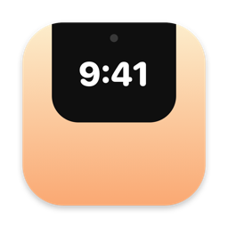

<p align="center"></p>

<h1 align="center">Brow</h1>

<p align="center">Hide the MacBook notch. Keep the time.<br>
A tiny, free, open-source menu bar app that blacks out the notch, can push your menu bar below it, and tucks a clock underneath.</p>

<p align="center">
  <a href="https://github.com/StephenLovino/Brow/releases/latest/download/Brow.zip"><b>Download for Mac</b></a> ·
  <a href="https://stephenlovino.github.io/Brow/">Website</a> ·
  <a href="LICENSE">MIT License</a>
</p>

## Install

Download `Brow.zip` from the [latest release](https://github.com/StephenLovino/Brow/releases/latest), unzip it, and drag **Brow.app** to Applications. It's signed with a Developer ID and notarized by Apple, so it opens like any other app.

Requires macOS 14 Sonoma or later, on Apple Silicon or Intel. Brow runs in the menu bar only, with no Dock icon.

## Features

- **Push everything below the notch**: switches the built-in display to its shorter mode (e.g. 1710×1112 → 1710×1068), so macOS puts the real menu bar and all windows under the notch and leaves the strip beside it black. The widget drawer then hangs from the middle of the menu bar. The change lasts only while Brow runs; quitting restores your resolution.
- **Rounded top corners**: Off, Small, Medium (default) or Large. Draws black slivers in the screen's top corners so they look rounded, which matters most once everything is pushed below the notch and the new top edge has square corners.
- **Black band**: *Around the notch* blacks out the notch plus a margin on each side. *Full width* blacks out the whole menu bar strip (menu items underneath still take clicks).
- **Widgets**: a drawer with the time, date and battery that drops down on hover, stays open, or stays hidden.
- Hold **⌥ Option** to fade the band out and see what's under it.

Everything Brow draws is click-through, so it never blocks the menu bar or windows below it. Brow makes no network requests.

## Build from source

```bash
git clone https://github.com/StephenLovino/Brow
cd Brow
swift run
```

## Releasing

`Packaging/release.sh` builds a universal `Brow.app`, signs it with your Developer ID (hardened runtime), notarizes it, staples the ticket, and writes `dist/Brow.zip`.

One-time setup, which stores an [app-specific password](https://support.apple.com/102654) in your keychain:

```bash
xcrun notarytool store-credentials brow-notary --apple-id you@example.com --team-id YOURTEAMID
```

Then:

```bash
VERSION=1.0.0 Packaging/release.sh
```

`SKIP_NOTARIZE=1` produces a signed build without notarizing. `SIGN_IDENTITY` and `NOTARY_PROFILE` override the defaults.

## Contributing

Issues and pull requests are welcome. Brow is a clean-room project: don't copy code from GPL-licensed notch apps into this repository. Work from public Apple documentation and observed behavior only.

## License

[MIT](LICENSE) © 2026 Stephen Jan Lovino
